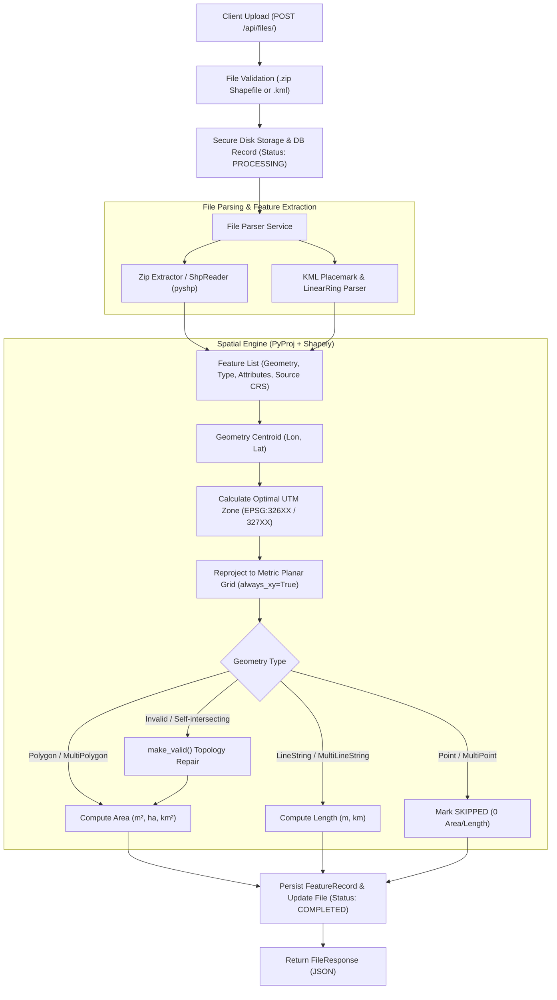

# AEREO · Geospatial File Measurement API

[](https://www.python.org/downloads/)
[](https://fastapi.tiangolo.com)
[](https://shapely.readthedocs.io/)
[](https://pyproj4.github.io/pyproj/)
[](https://opensource.org/licenses/MIT)

A high-performance, production-grade geospatial backend service built for **AEREO Cloud**. It accepts geospatial files (**Shapefiles in `.zip`** and **KML `.kml`**), parses spatial features and attributes, dynamically reprojects geographic coordinates (`EPSG:4326`) into optimal metric planar coordinate systems (UTM), and computes metric measurements (Polygon Area, LineString Length).

Includes interactive **Swagger API Docs (`/docs`)**, an enterprise **GIS Web Dashboard (`/`)** with live Leaflet map visualization, automated `pytest` test suites, and Docker containerization.

---

## 📑 Table of Contents
- [1. Problem Statement & Motivation](#1-problem-statement--motivation)
- [2. System Architecture](#2-system-architecture)
- [3. CRS Reprojection & Spatial Math Engine](#3-crs-reprojection--spatial-math-engine)
- [4. API Reference](#4-api-reference)
- [5. Setup & Running Locally](#5-setup--running-locally)
- [6. Running with Docker](#6-running-with-docker)
- [7. Automated Testing](#7-automated-testing)
- [8. Design Decisions & Trade-offs](#8-design-decisions--trade-offs)
- [9. Key Learnings & Future Scope](#9-key-learnings--future-scope)

---

## 1. Problem Statement & Motivation

Drone aerial surveys in mining pits, highway corridors, transmission lines, and solar parks produce vector boundary and alignment files formatted as **Shapefiles** and **KMLs**. To deliver actionable spatial intelligence, the backend must calculate:
- **Surface Area ($m^2$, hectares, $km^2$)** for excavation sectors, parcels, and stockpile polygons.
- **Linear Length (meters, km)** for access haul roads, pipelines, and transmission lines.
- **Graceful handling** of point features (boreholes, ground control stations) and complex topologies.

### The Core Geospatial Challenge: Geographic vs. Projected CRS
Most raw survey files use **WGS84 (`EPSG:4326`)**, where coordinates are recorded as angular **latitude and longitude in degrees**.
> **Important:** Calculating Euclidean area or length on degrees ($^\circ$) yields mathematically distorted numbers because degrees are not units of distance. The length of $1^\circ$ of longitude varies from ~111 km at the Equator down to $0$ km at the poles ($\Delta x \propto \cos(\text{latitude})$).

This service dynamically determines the centroid of incoming features, reprojects coordinates into the corresponding **Universal Transverse Mercator (UTM)** zone, and computes metric measurements.

---

## 2. System Architecture

```
d:\Aereo\
├── app/
│   ├── main.py              # FastAPI entry point, CORS, routes & static UI mount
│   ├── config.py            # Pydantic v2 application settings
│   ├── database.py          # SQLAlchemy session & SQLite connection
│   ├── models.py            # Relational database models (FileRecord, FeatureRecord)
│   ├── schemas.py           # Pydantic validation schemas & API contracts
│   ├── routers/
│   │   ├── files.py         # Ingestion, status, measurements & GeoJSON endpoints
│   │   ├── health.py        # System health & capabilities check
│   │   └── samples.py       # Pre-packaged demo dataset distributor
│   ├── services/
│   │   ├── crs_service.py   # Dynamic UTM zone calculation & PyProj reprojection
│   │   ├── measurement.py   # Shapely-based Area & Length computation + validation
│   │   └── file_parser.py   # Ingestion for zipped Shapefiles (.zip) and KML (.kml)
│   └── static/              # Minimal, professional GIS dashboard (HTML / CSS / JS / Leaflet)
├── sample_data/             # Real-world test datasets (Mining Pit KML & Corridor Shapefile)
├── scripts/
│   └── generate_samples.py  # Script for generating sample survey datasets
├── tests/                   # Pytest test suite (15 unit & integration tests)
├── Dockerfile               # Production Docker container
├── docker-compose.yml       # Docker Compose multi-service definition
├── requirements.txt         # Pinned Python dependencies
└── pytest.ini               # Pytest environment configuration
```

### Processing Flow Diagram



---

## 3. CRS Reprojection & Spatial Math Engine

### 1. Dynamic UTM Zone Formula
For input geometries in geographic angular coordinates ($EPSG:4326$), the application extracts the geometric centroid $(\lambda, \phi) = (\text{lon}, \text{lat})$ and maps it to the standard UTM grid (60 longitudinal zones of $6^\circ$ each):

$$\text{zone} = \left\lfloor \frac{\lambda + 180^\circ}{6^\circ} \right\rfloor + 1 \quad \text{where } 1 \le \text{zone} \le 60$$

$$\text{EPSG Code} = \begin{cases} 32600 + \text{zone} & \text{if } \phi \ge 0^\circ \text{ (Northern Hemisphere)} \\ 32700 + \text{zone} & \text{if } \phi < 0^\circ \text{ (Southern Hemisphere)} \end{cases}$$

*Example:* A drone survey conducted in Ballari, Karnataka ($\lambda \approx 76.92^\circ\text{E}, \phi \approx 15.15^\circ\text{N}$) evaluates to **Zone 43N**, mapped to **`EPSG:32643`**.

### 2. Coordinate Order Guarantee (`always_xy=True`)
Different GIS standards vary in axis order (some using `(lat, lon)` and others `(lon, lat)`). Using `pyproj.Transformer.from_crs(source_crs, target_crs, always_xy=True)` guarantees strict `(x, y)` / `(lon, lat)` planar order, eliminating flipped coordinate bugs.

---

## 4. API Reference

Interactive OpenAPI documentation is hosted at:
- **Swagger UI:** `http://localhost:8000/docs`
- **ReDoc:** `http://localhost:8000/redoc`

### Endpoints Overview

| Method | Endpoint | Description |
| :--- | :--- | :--- |
| `POST` | `/api/files/` | Uploads and processes a geospatial file (`.zip` or `.kml`) |
| `GET` | `/api/files/{id}/` | Retrieves metadata, feature count, CRS, and processing status |
| `GET` | `/api/files/{id}/measurements/` | Retrieves calculated metric measurements for each feature |
| `GET` | `/api/files/{id}/features/` | Exports features as a standard GeoJSON `FeatureCollection` |
| `GET` | `/api/files/` | Lists all uploaded files (descending by date) |
| `DELETE` | `/api/files/{id}/` | Deletes a file, its database records, and disk assets |
| `GET` | `/api/health/` | Service health status and supported capabilities |

---

### Request & Response Examples

#### 1. Upload File (`POST /api/files/`)
```bash
curl -X POST "http://localhost:8000/api/files/" \
  -H "accept: application/json" \
  -F "file=@sample_data/sample_mining_pit.kml"
```
**Response (`201 Created`):**
```json
{
  "id": "7a3e8b19f04c",
  "filename": "sample_mining_pit.kml",
  "feature_count": 5,
  "crs": "EPSG:4326",
  "projected_crs": "EPSG:32643 (UTM Zone 43N)",
  "status": "COMPLETED",
  "file_format": "kml",
  "file_size_bytes": 2840,
  "created_at": "2026-10-11T21:15:00.123456",
  "error_message": null
}
```

#### 2. Get File Information (`GET /api/files/{id}/`)
```bash
curl -X GET "http://localhost:8000/api/files/7a3e8b19f04c/"
```
**Response (`200 OK`):**
```json
{
  "id": "7a3e8b19f04c",
  "filename": "sample_mining_pit.kml",
  "feature_count": 5,
  "crs": "EPSG:4326",
  "projected_crs": "EPSG:32643 (UTM Zone 43N)",
  "status": "COMPLETED"
}
```

#### 3. Get Measurements (`GET /api/files/{id}/measurements/`)
```bash
curl -X GET "http://localhost:8000/api/files/7a3e8b19f04c/measurements/"
```
**Response (`200 OK`):**
```json
{
  "file_id": "7a3e8b19f04c",
  "filename": "sample_mining_pit.kml",
  "feature_count": 5,
  "source_crs": "EPSG:4326",
  "projected_crs": "EPSG:32643 (UTM Zone 43N)",
  "status": "COMPLETED",
  "summary": {
    "total_area_sq_meters": 384210.45,
    "total_area_hectares": 38.421,
    "total_length_meters": 1782.34,
    "total_length_km": 1.7823,
    "features_calculated": 3,
    "features_skipped": 2,
    "features_unsupported_or_error": 0
  },
  "features": [
    {
      "feature_index": 0,
      "feature_name": "Pit Extraction Sector Alpha",
      "geometry_type": "Polygon",
      "measurement": {
        "area": {
          "square_meters": 245100.22,
          "hectares": 24.51,
          "square_kilometers": 0.2451
        }
      },
      "projected_crs": "EPSG:32643 (UTM Zone 43N)",
      "status": "CALCULATED",
      "notes": null,
      "properties": {
        "SiteID": "BLR-PIT-01",
        "Material": "Hematite / Iron Ore"
      }
    },
    {
      "feature_index": 2,
      "feature_name": "Primary Haul Road Alignment",
      "geometry_type": "LineString",
      "measurement": {
        "length": {
          "meters": 1782.34,
          "kilometers": 1.7823
        }
      },
      "projected_crs": "EPSG:32643 (UTM Zone 43N)",
      "status": "CALCULATED",
      "notes": null,
      "properties": {
        "RouteID": "RD-MAIN-01",
        "WidthMeters": "14.5"
      }
    },
    {
      "feature_index": 3,
      "feature_name": "Borehole Exploration MB-01",
      "geometry_type": "Point",
      "measurement": null,
      "projected_crs": null,
      "status": "SKIPPED",
      "notes": "Point geometry does not have measurable area or length",
      "properties": {
        "name": "Borehole Exploration MB-01"
      }
    }
  ]
}
```

---

## 5. Setup & Running Locally

### Prerequisites
- Python 3.10+
- `pip` and `git`

### 1. Clone & Set Up Virtual Environment
```bash
# Clone the repository
git clone <your-repo-url>
cd Aereo

# Create virtual environment
python -m venv venv

# Activate virtual environment
# Windows (PowerShell):
.\venv\Scripts\Activate.ps1
# Linux / macOS:
source venv/bin/activate
```

### 2. Install Dependencies
```bash
pip install -r requirements.txt
```

### 3. Generate Sample Data
```bash
python scripts/generate_samples.py
```

### 4. Start the Application Server
```bash
uvicorn app.main:app --reload --host 0.0.0.0 --port 8000
```
Open your browser at:
- **Web Dashboard:** [http://localhost:8000/](http://localhost:8000/)
- **Interactive Swagger Docs:** [http://localhost:8000/docs](http://localhost:8000/docs)

---

## 6. Running with Docker

Run the entire application in a standardized container with one command:

```bash
docker-compose up --build
```
The API and Web UI will immediately be available at `http://localhost:8000`.

To stop the container:
```bash
docker-compose down
```

---

## 7. Automated Testing

The test suite covers:
- Input validation (unsupported extensions, oversized payloads).
- Dynamic UTM zone calculation across multiple continents and hemispheres.
- Coordinate reprojection accuracy with PyProj.
- Polygon Area and LineString Length metric calculation.
- Self-intersecting polygon topology fixing via `shapely.make_valid`.
- Point skipping without system failure.
- End-to-end API lifecycle (upload, query, measurements, GeoJSON export, deletion).

Run tests with `pytest`:
```bash
pytest -v
```

**Test Execution Results:**
```
tests/test_api_endpoints.py::test_health_check PASSED                    [  6%]
tests/test_api_endpoints.py::test_upload_invalid_extension PASSED        [ 13%]
tests/test_api_endpoints.py::test_upload_and_process_kml PASSED          [ 20%]
tests/test_api_endpoints.py::test_upload_and_process_shapefile_zip PASSED [ 26%]
tests/test_api_endpoints.py::test_get_nonexistent_file_404 PASSED        [ 33%]
tests/test_crs_service.py::test_utm_zone_calculation PASSED              [ 40%]
tests/test_crs_service.py::test_crs_parsing PASSED                       [ 46%]
tests/test_crs_service.py::test_get_projected_crs_for_geographic_geometry PASSED [ 53%]
tests/test_crs_service.py::test_reproject_geometry PASSED                [ 60%]
tests/test_file_parser.py::test_parse_kml_file PASSED                    [ 66%]
tests/test_file_parser.py::test_parse_shapefile_zip PASSED               [ 73%]
tests/test_measurements.py::test_polygon_area_calculation PASSED         [ 80%]
tests/test_measurements.py::test_linestring_length_calculation PASSED    [ 86%]
tests/test_measurements.py::test_point_handling_skipped PASSED           [ 93%]
tests/test_measurements.py::test_self_intersecting_polygon_make_valid PASSED [100%]

======================== 15 passed in 0.64s ========================
```

---

## 8. Design Decisions & Trade-offs

### 1. Framework: FastAPI vs. Django + DRF
* **Decision:** Selected **FastAPI**.
* **Rationale:** This service is a high-throughput spatial processing microservice. FastAPI offers native async request streaming, Pydantic v2 data validation, and built-in interactive OpenAPI/Swagger interfaces without the heavyweight overhead of Django's admin panels or sessions.

### 2. Parsing Architecture: PyShp + Shapely vs. C-GDAL / Fiona
* **Decision:** Implemented parsing using `pyshp` (pure Python) alongside `shapely` (GEOS C-wheels) and `pyproj` (PROJ wheels).
* **Rationale:** Standard GDAL/Fiona distributions frequently fail to build or link dynamic C++ runtime libraries across diverse developer environments (especially Windows and Alpine Linux). Using pure Python Shapefile parsing paired with pre-compiled Shapely/PyProj wheels guarantees zero installation friction while maintaining full C-level geometry computation performance.

### 3. CRS Strategy: Dynamic UTM vs. Web Mercator (`EPSG:3857`)
* **Decision:** Dynamically project into local **UTM zones** (`EPSG:326XX` / `EPSG:327XX`) rather than Web Mercator.
* **Rationale:** Web Mercator (`EPSG:3857`) is standard for web tile rendering, but introduces severe metric distortion away from the Equator (scale factor $k = 1 / \cos(\phi)$). In contrast, UTM is a conformal transverse cylindrical projection with minimal scale distortion ($< 0.04\%$ along central meridians), making it the industry standard for surveying, drone mapping, and engineering measurements.

### 4. Resilient Geometry Handling
* **Decision:** Applied `shapely.validation.make_valid` prior to calculating measurements.
* **Rationale:** Real-world CAD and drone vector exports often contain self-intersecting "bow-tie" rings or collapsed slivers. Automatically repairing topological anomalies prevents the pipeline from crashing on imperfect real-world survey files.

---

## 9. Key Learnings & Future Scope

### Key Learnings
1. **Cartographic Nuance:** Handling spatial data requires respecting coordinate reference frames. Assuming Euclidean flat-plane geometry on WGS84 angular degrees leads to completely erroneous metric calculations.
2. **KML Namespace Structure:** KML files often contain varied XML namespaces (`http://www.opengis.net/kml/2.2` vs. legacy Google Earth schemas). Building a namespace-agnostic XML traversal ensures consistent placemark and coordinate extraction.
3. **Database Decoupling:** Storing geometries in GeoJSON format within relational tables allows standard SQL databases (SQLite, PostgreSQL) to support spatial APIs without strictly requiring a PostGIS extension for basic querying.

### Future Scope
1. **Asynchronous Background Worker Queue:** Integrate Celery or ARQ with Redis to decouple processing of massive vector datasets (>100,000 features) from the HTTP request cycle.
2. **3D Volumetric Measurements:** Extend the engine to process Digital Elevation Models (DEM/DSM) and 3D point clouds (`.las` / `.laz`) to calculate stockpile volumes ($m^3$) and cut/fill earthwork balances.
3. **Multi-temporal Diffing:** Add change-detection endpoints that compare two survey epochs over the same spatial boundary to detect volume excavation rates and progress tracking over time.
4. **Cloud Object Storage:** Integrate Amazon S3 or Google Cloud Storage (GCS) pre-signed upload URLs for direct streaming of multi-gigabyte survey packages.
